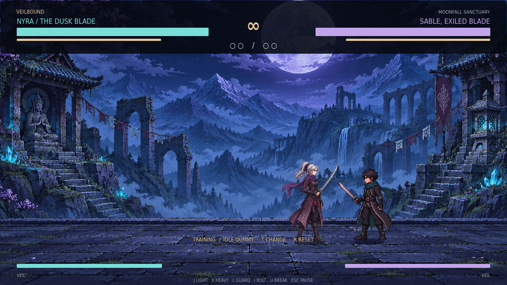

# Veilbound — The Shattered Veil

A complete single-player sword-fighting game built in **Godot 4.6**, set in the moonlit ruins of Moonfall Sanctuary. Choose a fighter, break three seals in Arcade, or refine your technique in Training.



## Play

1. Download this repository with **Code → Download ZIP**, or clone it.
2. Install **Godot 4.6 or newer** (standard edition; no .NET required).
3. Import `project.godot` in Godot's Project Manager.
4. Press **F5** to play. Choose Arcade, Quick Duel, or Training.

The game runs offline on the desktop. No accounts, API keys, asset downloads, or external services are required after opening the project. The source can be exported through Godot for macOS, Windows, or Linux after installing the matching export templates.

## What is included

- **Two playable fighters:** Kael, a balanced swordsman, and Nyra, a faster duelist with lighter attacks.
- **Three-seal Arcade:** three increasingly difficult rivals, each fought in a best-of-three match, with an ending and retry flow.
- **Quick Duel** and **Training**, with idle, guarding, and active rival behavior.
- **Three difficulty levels** and three atmospheric treatments of Moonfall Sanctuary.
- **Eight visual poses per fighter:** ready, walk, windup, slash, recoil, guard, and jump states.
- **Original arena and fighter artwork**, animated ambient particles, slash trails, sparks, damage numbers, hitstop, camera shake, and impact flashes.
- **Original synthesized music and effects** for strikes, guards, parries, projectiles, movement, and results.
- **Three-hit light chains**, heavy strikes, Veil bolts, and a full-meter Veil Break.
- **Directional guard, timed parries, stamina costs, guard breaks, and invulnerable dodges**.
- **Input buffering, coyote time, jump buffering, full active-window hit detection, and one hit per swing**.
- **Complete menus:** title, fighter selection, controls, options, pause, round announcements, results, and credits.
- **Persistent settings and career records**, key rebinding, gamepad actions, volume sliders, fullscreen, and optional screen shake/flashes.

This release is a local single-player game against AI. Online multiplayer and local two-player versus are outside its current feature set.

## Keyboard controls

| Action | Default key |
| --- | --- |
| Move | A / D, or left / right arrows |
| Jump | W, up arrow, or Space |
| Light / chain | J |
| Heavy strike | K |
| Guard / timed parry | L |
| Dodge | Shift |
| Veil bolt | I |
| Veil Break at full meter | U |
| Pause / back | Esc |
| Restart duel / reset training | R |
| Change training dummy | T |
| Debug hitboxes | F3 |
| Fullscreen | F11 |

Primary bindings can be changed in Options. Fixed menu keys remain reserved. Selecting a key already used by another primary action swaps those bindings.

**Gamepad:** left stick / D-pad to move, A to jump, X light, Y heavy, B dodge, LB guard, RB bolt, right stick click Veil Break, Start pause. Labels use Xbox-style names; equivalent controller buttons follow the same mapping.

## Combat notes

- The first light attack retains **0.08s windup**, **0.10s active time**, and **0.40s attack-start cooldown**.
- Repeated light inputs buffer briefly. Further cuts can cancel recovery once their cooldown permits.
- Guard only protects the front. Start guarding just before impact to parry.
- Heavy attacks, dodges, projectiles, and blocked hits consume stamina. An exhausted guard breaks.
- Dealing or taking damage builds Veil. At 100%, Veil Break delivers a large close-range strike; it can still be blocked or evaded.
- Training restores defeated fighters and lets you reset their positions, health, stamina, and full Veil meters.

## Move lab

The [`move-lab/`](move-lab/) browser tool is included for designing move values, comparing timing, and experimenting with combo links. It has its own README and eight scheduling tests. Its JSON is a separate design format; it does not automatically modify the game's move data.

## Validation

With Godot 4.6 on your PATH:

```sh
godot --headless --path . --editor --import --quit
godot --headless --path . --script res://tests/combat_test.gd
```

The automated suite exercises combat rules, active-window detection, resources, training reset, round and arcade flow, both fighters, pause/resume, and menu construction. The game has also been opened and played in the Godot editor for visual and input checks.

For the lab, run `npm test` from `move-lab/` using Node.js 18 or later. No npm packages are required.

## Project layout

| Location | Purpose |
| --- | --- |
| `scripts/fighter_base.gd` | Shared combat, movement, resource, animation, and hit rules |
| `scripts/moves.gd` | Move data |
| `scripts/player.gd` | Player commands |
| `scripts/enemy.gd` | Rival decision-making |
| `scripts/game.gd` | Menus, round flow, Arcade, training, and effects routing |
| `scripts/hud.gd` | Interface and settings controls |
| `scripts/stage.gd` | Arena background, ambience, and impact graphics |
| `scripts/audio_manager.gd` | Original music and sound synthesis |
| `scripts/save_manager.gd` | Settings and career records |
| `art/` | Arena, fighters, icon, and licensed interface fonts |
| `tests/` | Headless game checks |
| `move-lab/` | Browser combat-design tool, excluded from Godot imports |

See [architecture](docs/ARCHITECTURE.md), [design](docs/GAME_DESIGN.md), and the [manual test plan](docs/TEST_PLAN.md). All rights reserved; the bundled DejaVu fonts retain their own included license.
